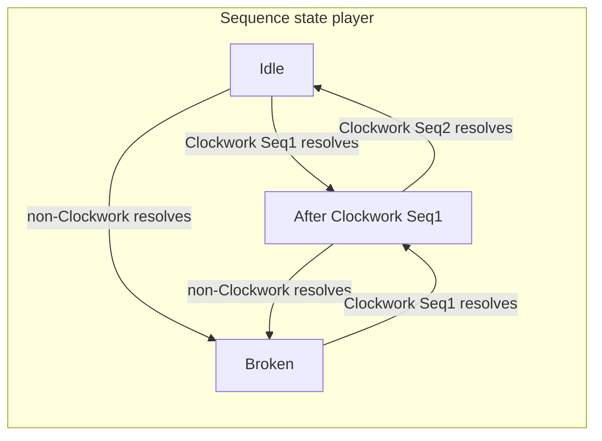

---

name: Clockwork Collective Faction
overview: Design and implementation plan for the Clockwork Collective faction with **Prime** (slots 3, 5, 7) and **Sequence** (1–5 ladder) mechanics, including authored card kits for awakening 0 and 1, balance targets vs all–Basic Strike opponents, and engine/state additions aligned with the existing combat queue model.
todos:

- id: types-state
content: Add FighterState fields + keyword/effect types for Prime, temporary prime, Sequence; faction string `clockwork`
status: pending
- id: engine
content: "Implement gating: prime slot check, Prime riders as DirectHpDamage vs Sequence StrikeDamage + potency, sequence chain update, non-clockwork clears chain"
status: pending
- id: content-aw0
content: Author awakening0.json Clockwork kit (~13 cards) Seq1/2, Prime direct, Prime Faith (Faith stacks), Prime battery, Hymn Shelter + Hymn Invigoration + Prime Purification
status: pending
- id: content-aw1
content: Author awakening1.json payoffs (Seq3–5 songs, temporary prime, Prime/Faith builders, Faith threshold utility cards)
status: pending
- id: tests-balance
content: Add combat tests + sim/deck lineup vs basic enemy (40 HP Aw0, 80 HP Aw1)
status: pending
- id: keyword-faith-relics
content: Implement Faith stacking buff hook; Septenary Crown rare + uncommon relic stubs; Armageddon card; Wild Sequence rule
status: pending
- id: pilot-aw2-verity
content: Extend PilotDef with optional aw2 trait slot; grant clockwork_verity_aw2 at spirit awakening 2 for Canon Verity
status: pending

---

# Clockwork Collective — Prime + Sequence

## Combat model (existing)

- **Queue:** 9 slots (`[COMBAT_RULES.queueSize](../src/core/rules.ts)`); empty slots resolve as `[neutral_basic_strike_t1](../src/data/cards/neutral/awakening0.json)` (2 **Strike** damage, 0 charge).
- **Round structure:** Each combat round is **player activation** then **enemy activation** (`[CombatSimulator.run](../src/core/combat/engine.ts)`) — one card resolution per fighter per round.
- **“Turn 9”:** Interpret as **round 9** = nine player resolutions. In the first full pass with `queueCursor` starting at 0, the player hits **1-based slots 3, 5, 7** on **rounds 3, 5, 7** — matching **Prime** slots.

## Prime (design)

- **Prime slots (1-based):** **3, 5, 7** → **0-based indices 2, 4, 6** (consistent with `[glint_aw1](../src/core/traits.ts)` using `queueIndex + 1` for display slots).
- **Damage flavor — “mystical” / non-Strike:** **Prime** damage should **not** use the **Strike** tag path. Author as **direct HP damage** (printed “Deal **X** damage” — no **Strike** keyword on those packets). In data, prefer `**DirectHpDamage`** (`[types.ts](../src/core/types.ts)`) for Prime riders so it does **not** feed enemy **Expose**-on-strike hooks, **Feint** chains, etc., unless you deliberately add a card that bridges both.
- **Balance:** **Direct** Prime riders should be **slightly higher** than an equivalent **Strike** at the same charge tier (rule of thumb **~+1** damage or **~10–15%** — tune in sim) so the mystical lane is not strictly weaker than the combo lane.
- **Card text pattern:** small **baseline** (often **direct** damage or **heal**, not Strike); **Prime:** big **direct** rider on slots 3 / 5 / 7 — reads like **sanction / geometry**, not a punch combo.
- **Extra systems:**
  - **Buff cards in prime slots:** implemented as auras or `FighterState` flags (e.g. `primeSlotDamageBonus: Record<queueIndex, number>` or keyed by slot).
  - **Temporary prime:** “Next **N** distinct queue positions resolve as Prime” — store `temporaryPrimeRemaining: number` and decrement when a resolution consumes one, **or** mark the next N **slot indices** that will be treated as prime when visited (clearer for “next 2 slots”).
  - **Already primed → +1 energy:** when applying temporary prime to a slot that is **naturally** prime, grant **+1 charge** once (needs dedupe per application).

## Sequence (design)

- **Strike / combo flavor:** **Sequence** lines are the **fighting-game string** — **Strike** damage (`StrikeDamage`), multi-hit feel, and **scaling** via `**AddStrikePotency`** (and future strike-tagged riders) so the chain **ramps** like a combo (`AddStrikePotency` in `[runner.ts](../src/core/effects/runner.ts)`). Weave **+1 / +2 potency** on **Sequence Start** or **Sequence 2+** bonuses on several cards so later **Strikes** in the fight hit harder.
- **Ladder:** Cards carry **Sequence** labels (e.g. keyword specs or a new field) with one or more numbers **1–5**. Awakening 0 content only needs **1 and 2**; Aw1 extends toward **3–5** for bigger payoffs.
- **Rule (your clarification):** **Non-Clockwork plays break the sequence chain.** Concretely for implementation:
  - On each **player** card resolution, if `card.faction !== 'clockwork'` (exact string TBD to match JSON), set sequence state to **broken / idle** (no expected next step).
  - If the card **is** Clockwork, evaluate Sequence: **Sequence 1** cards can always fire their “opener” line; **Sequence N>1** bonus lines require that the **previous player resolution** was a Clockwork card that **completed** the **N−1** step (see state below).
- **Cards with multiple Sequence numbers:** Author as a set, e.g. `{1,2}` — effect pipeline branches: behaves as **1** when chain is idle; can also **bridge** to **2** when previous step was **1** (single card can restart or continue — tune per card).

**Suggested minimal state on `[FighterState](../src/core/types.ts)`:**

- `clockworkSequencePrev: number | null` — highest **completed** sequence step from the **immediately previous Clockwork** resolution (or `null` if idle/broken).
- Reset to `null` when a non-Clockwork card resolves (including neutral basics).

**Resolution order:** Update `clockworkSequencePrev` **after** the card’s effects resolve (consistent with trait `onCardResolved` timing in `[resolver.ts](../src/core/combat/resolver.ts)`).

## Engine work (implementation outline)

| Area              | Work                                                                                                                                                                                                                                                                                                                               |
| ----------------- | ---------------------------------------------------------------------------------------------------------------------------------------------------------------------------------------------------------------------------------------------------------------------------------------------------------------------------------- |
| Types             | `KeywordSpec` extension or parallel authoring for `Prime` / `Sequence`; optional `EffectStep` branches: `BranchIfOnPrimeSlot`, `BranchIfClockworkSequence`, `GrantTemporaryPrime`, `BuffPrimeSlots`.                                                                                                                               |
| Resolver / runner | Pass `queueIndex` into pipeline context (already available in `[resolveCard](../src/core/combat/resolver.ts)`); implement prime checks and sequence gating in `[runner.ts](../src/core/effects/runner.ts)` — **Prime** riders often `**DirectHpDamage`**; Sequence riders `**StrikeDamage`** + `**AddStrikePotency**` as designed. |
| Expand            | If any branch depends on snapshot-only data, extend `[expandEffectSteps](../src/core/effects/expandEffects.ts)` similarly to junk/core branches.                                                                                                                                                                                   |
| Content           | New JSON packs: e.g. `[src/data/cards/clockwork/awakening0.json](../src/data/cards/clockwork/awakening0.json)`, `awakening1.json`; `faction: "clockwork"`, `neutral: false`, `awakening_min` 0/1.                                                                                                                                  |
| Pilots            | Add pilot(s) in `[pilots.ts](../src/core/pilots.ts)` + traits in `[traits.ts](../src/core/traits.ts)` when ready (can ship cards before full pilot roster).                                                                                                                                                                        |
| Docs              | Short design blurb (only if you want parity with `[docs/scavenger-cards.md](scavenger-cards.md)`) — optional.                                                                                                                                                                                                                      |
| Balance           | Add a **deck duel** or **forge sim** lineup: player all-Clockwork queue vs enemy **nine** `neutral_basic_strike_t1` (or full 9-slot basic line); optionally **enemy HP ×2** for Aw1 goal (`[COMBAT_RULES.startingHp](../src/core/rules.ts)` is 40 — override in test/setup only).                                                  |

## Balance targets (design intent)

- **Baseline threat:** All-basic enemy deals **2 HP/round** before block — **18** damage over **9** rounds if unmitigated.
- **Aw0 vs 40 HP basic enemy:** Win by **round 9** with a **pure Clockwork** queue (no neutrals — they **break Sequence**), or win slower by **out-valuing** via **Prime** burst + blocks. Rough average damage needed to kill in 9 rounds: **~4.4 HP/player round** (ignoring shield decay nuances) — **Prime** turns (3, 5, 7) and **Sequence 2** payoffs carry the spike.
- **Aw1 vs “double our health” (80 HP enemy, 40 player):** Cards add **flex** (extra Sequence steps, prime setup, charge), **bigger payoffs** on **Sequence 3+**, and/or **sustain** so the line can close **within fatigue window** (`maxRounds` 24) or faster.

---

## Sequence wording on cards (rules text)

Use these **exact phrases** on printed card rules (engine may still store `sequenceStep: 1 | 2 | 3` internally):

| Step                 | Rules line          |
| -------------------- | ------------------- |
| Open / restart chain | **Sequence Start:** |
| Second link          | **Sequence 2:**     |
| Third link           | **Sequence 3:**     |
| Fourth link (Aw1)    | **Sequence 4:**     |

**Song naming convention (card titles):**

- Sequence cards use `**Song Name: Section`**.
- Section order follows your musical flow: **Introduction → Verse → Bridge → Chorus → Coda**.
- Card text still prints mechanical lines as **Sequence Start / 2 / 3 / 4 / 5**.
- A single deck should interleave at least two songs so players are not locked to one linear chain.

**Interleaving target (design):**

- Include a **Strike song** and a **Shield song** that can each win independently.
- Add 2–3 “cross-over” cards that carry sections from one song but reward the other lane (e.g., Strike body + shield rider, or Shield body + potency rider).
- Keep Prime/Faith cards song-agnostic so both songs can route through the same Prime spikes.

**Card text pattern:** small **baseline** always; **Sequence Start / 2 / 3** lines are the **bonus** when that step’s gate is satisfied — prefer **Strike** + occasional **potency** on those lines. **Prime**-focused cards: **weak baseline** (often **direct** damage or **heal**, not Strike), **Prime:** strong **direct** rider on slots 3 / 5 / 7. **Mixed** cards (Sequence + Prime on one line) should **split** types: Sequence packet = **Strike**, Prime packet = **direct** (see interleave cards below).

**Cost model update (important):**

- **Sequence cards use HP costs, not charge costs**, so energy starvation does not break chains.
- Author as a self-damage cost primitive (e.g. `SelfDamage` / cost-at-resolve variant) with floor safeguards where needed (`SelfDamageRespectFloor1` if the card should not self-KO).
- Non-Sequence Clockwork cards may still use charge normally (Prime setup, Hymns, utility).

**Healing (faction flavor):** Religious-order fantasy is supported with **HealSelf**-style effects (`HealSelf` in `[runner.ts](../src/core/effects/runner.ts)`). Pair **small heals** with **Prime** aggression so the faction still reads **order + math**, not pure lifegain.

**Card titles (Sequence 2 payoffs):** use **Successor**, **Succeeding**, *or* **Follow Up** in the title — pick whichever reads better with the rest of the name (all refer to the same **Sequence 2:** rules line). **Successor** / **Succeeding** lean **math** (e.g. successor step, succeeding case). **Follow Up** / **Follow-Up** lean **liturgical** (“the follow-up reading,” “the next motion”). **Prime**-prefixed names still suit prime-slot identity.

`**Hymn:`** **Persistent** cards use the title pattern `**Hymn:`** *subtitle* (e.g. **Hymn: Warmth**) so players learn **ongoing liturgy** at a glance; still include the **Persistent** keyword in data for **Continuous / Persistent** deck limits.

---

## Proposed Aw0 cards (13; all `faction: clockwork`, `awakening_min: 0`)

Author at **tier 1** unless merge ladder is added later. Stats are sim starting points.

1. **Song of Iron: Introduction** — Strike **1**. **Sequence Start:** Strike **2**, **+1** strike potency. Charge **1**. *Strike song opener; potency seeds later Strikes in the fight.*
2. **Prime Interdict** — Deal **1** damage (direct, not **Strike**). **Prime:** Deal **5** damage (direct — tuned **above** a comparable **Strike** packet). Charge **1**. *Mystical “interdiction” on prime slots.*
3. **Song of Iron: Verse** — Strike **1**. **Sequence 2:** Strike **4**, **+1** strike potency. Charge **1**. *Strike song follow-up; potency ramp.*
4. **Song of Sanctuary: Introduction** — Block **3**. **Sequence Start:** Block **6**. Charge **1**. *Shield song opener; can anchor defensive wins.*
5. **Song of Iron: Bridge** — **+1 strike potency**. **Sequence 3:** **Strike 3**, **Shield 3**. **Prime:** **Delayed Strike 5**, **Delayed Shield 5**. **HP cost** (tune, e.g. **2**). *True bridge at step 3; Prime delay loads the next section so either Strike/Shield route benefits.*
6. **Prime Bulwark** — Block **3**. **Prime:** **+4** block. Charge **1**. *Defense spike on prime slots (still no Strike path).*
7. **Capacitor Canticle** — Gain **1** charge. **Sequence Start:** gain **+1** charge, **Strike 2**, **+1** strike potency. Charge **0**. *Battery + combo setup.*
8. **Canticle Interleave: Verse** — Strike **1**. **Sequence 2:** Strike **3** (Strike). **Prime:** Deal **3** damage (direct — **not** Strike). **HP cost** (tune). *Cross-over card: sets up Song of Iron: Bridge while still paying into Prime/Faith lines.*
9. **Prime Purification** — Heal **3**. **Prime:** Deal **4** damage (direct). Charge **1**. *Heal + sanctified damage; rider bumped vs old **Strike** version.*
10. **Prime Faith** — Deal **1** damage (direct). **Prime:** gain **Faith 1** for the rest of this combat. **Faith:** each stack gives cards you resolve from **Prime** slots **+1** damage (**Strike** and **direct**). Charge **1**. *Prime-slot damage engine; pairs with **Follow-Up Lattice** (potency vs flat bonus).*
11. **Hymn: Shelter** — **Persistent**, `**Hymn:`** title. **Start of your turn:** gain **1** block (shield). **When you resolve a card on a Prime slot** (prime **activation**): heal **2** HP. Charge **1** (tune). *Defensive hymn at Aw0; counts toward **Continuous / Persistent** deck cap alongside **Hymn: Warmth** — pick **two** max combined.*
12. **Prime Spark** — Gain **Faith 1** (baseline). **Prime:** gain **+1 charge**. Charge **0**. *Aw0 Prime battery so Prime-first decks can sustain energy without Sequence routing.*
13. **Hymn: Invigoration** — **Persistent**, `**Hymn:`** title. Baseline pulse by tier: **t1:** every **3** turns gain **Faith 1**; **t2:** every **2** turns gain **Faith 1**; **t3:** every **1** turn gain **Faith 1**. **Prime:** gain **+3 charge**. Charge **1** (tune). *Prime-slot engine hymn; big resource payoff in exchange for occupying a prime-capable slot.*

**Kit notes:** Fill all nine slots with Clockwork if using strict chain-break rules. Curve: **Sequence** cards carry **Strike + potency** scaling and primarily spend **HP** (not charge); **Prime**-named cards emphasize **direct** damage or **heal** + **direct**; **Prime Faith** builds **Faith** stacks that buff **Prime-slot** damage. Keep at least one **Song of Iron** line and one **Song of Sanctuary** line live so the deck can pivot between damage-race and shield attrition.

---

## Proposed Aw1 cards (`awakening_min: 1`)

Focus: **Sequence 3+** finishers plus a dedicated **Prime/Faith** sub-kit: Faith generation that also grants energy, and Prime threshold cards where baseline is damage and threshold payoffs are utility (stun/weaken/heal), not more damage.

1. **Song of Iron: Chorus** — Strike **1**. **Sequence 4:** Strike **7**, **+2** strike potency. **HP cost** (tune). *Big **Strike** song climax fed by Bridge delay payloads.*
2. **Prime Consecration** — Deal **2** damage (direct). **Prime:** the next **two** distinct slot resolutions count as **Prime**; if a visit is already natural **Prime**, **+1** charge. Charge **1**. *Setup card — mystical baseline, not a **Strike**.*
3. **Song of Sanctuary: Verse** — Block **2**. **Sequence 2:** cards in **prime** slots gain **+2** strike potency until end of combat (aura by slot). **HP cost** (tune low, e.g. **1**) or **charge 1** if this is designated non-Sequence utility. *Shield song progression with offensive scaling.*
4. **Canticle Interleave: Chorus** — Strike **1**. **Sequence Start:** Strike **2**, **+1** potency; **Sequence 2:** Strike **3**, **+1** potency; **Sequence 3:** Strike **4**, **+2** potency (additive **Strike** packets — tune). **HP cost** (tune). *Cross-over chorus; links both songs and rewards interleaving.*
5. **Song of Iron: Coda** — Strike **1**. **Sequence 5:** Strike **8**, **+2** strike potency. **HP cost** (tune high). *Strike song endcap; Sequence 5 can feed Armageddon hooks.*
6. **Hymn: Warmth** — Title pattern `**Hymn:`** *name* signals **rest-of-combat** / **Persistent** (still author **Persistent** in data for deck rules). **Start of your turn:** heal **2** HP. **When you resolve a card on a Prime slot (3 / 5 / 7):** deal **5** damage (direct — bumped vs Strike alternatives). Charge **2** (tune). *Prime = direct sanctified damage, not **Strike**.*
7. **Recursive Canon** *(working title)* — **Prime:** Choose **one** queue **slot** (or **the current slot** — tune). For the **rest of this combat**, that **slot index** **counts as Prime** when visited. **Bonus-resolve** the **previous** card you resolved **once**, **immediately** *(same timing band as **Overclock** / bonus-next — see `[resolver.ts](../src/core/combat/resolver.ts)`)*. Charge **2–3** (tune). *Engine: temporary Prime flag per slot + `resolveBonusNext`-style hook.*

### Aw1 Prime/Faith additions (new)

1. **Prime Benediction** — Gain **Faith 1** (baseline). **Prime:** gain **+1 Faith** and **+1 charge**. Charge **1**. *Core Faith/energy builder; keeps Prime lane online.*
2. **Prime Tithe** — Gain **Faith 2** (baseline). **Prime:** gain **+1 Faith** and **+1 charge**. Charge **2**. *Greedier “flavor” of faith generation for long fights.*
3. **Judgment by Measure** — Deal **4** damage (direct). **If Faith ≥ 3:** apply **Stunned 1** (or your stun equivalent) to enemy. Charge **1**. *Threshold utility, no threshold damage.*
4. **Mercy of the Lattice** — Deal **3** damage (direct). **If Faith ≥ 4:** **heal 4** HP. Charge **1**. *Threshold sustain, no threshold damage.*
5. **Ordinance of Silence** — Deal **3** damage (direct). **If Faith ≥ 5:** apply **Weaken** *(define as “enemy deals -X next strike” or existing weaken keyword)*. Charge **2**. *Threshold control, no threshold damage.*
6. **Prime Cataclysm** — Deal **5** damage (direct). **If Faith ≥ 6:** deal **12** additional damage (direct). **Prime:** gain **+1 charge**. Charge **2**. *Prime lane finisher; explicit Faith damage threshold payoff.*

**Kit notes:** Aw1 uses heavier **HP-costed Sequence** finishers (Bridge→Chorus→Coda) while Prime/Hymn/utility can keep charge costs. Bridge’s **Delayed Strike/Shield** payload intentionally strengthens Chorus and keeps both strike/shield routes viable. Prime lane now has explicit **Faith + energy** builders (with **baseline Faith gain** as their core identity) and **Faith-threshold utility** payoffs where thresholds do **not** add damage.

---

## Keyword — **Faith** *(tentative data name: `Faith`)*

**Why:** **Prime Faith** and relics both care about **extra damage when a Prime slot “activates.”** Use one stacking buff so the rules are explicit.

- **Player-facing:** “**Faith X**” means you have **X** stacks of **Faith**.
- **Effect:** For each **Faith** stack, cards you resolve from **Prime** slots deal **+1** damage (**Strike** and **direct**).
- **Stacking:** Additive from any source (cards, relics, traits). If you gain **Faith 1** three times, Prime-slot cards gain **+3** damage.
- **Implementation sketch:** `FighterState.faithStacks` + Prime-slot resolve hook.

---

## Wild Sequence *(optional faction rule — relic / mastery)*

When a **Prime** rider **activates** on a **natural** Prime slot **(display 3, 5, or 7)** — i.e. you actually got the **Prime:** line on a **faction-natural** holy index — that card’s printed **Sequence** numbers behave as **wild** for **one** link: **any** **Sequence Start / 2 / 3** gate may treat this resolution as satisfying **one** step of your choice *(exact template: “may count as Sequence N for chain state” — tune so it cannot loop infinitely)*.

*Use on **rare relic** below or as a future keyword **Wild** / **Canticle**.*

---

## Proposed relics (`faction: clockwork`)

Relics are **design stubs** until a relic pipeline exists; mirror rarity like other factions.

### Uncommon *(examples)*

| Name *(working)*    | Effect *(summary)*                                                                                                                                   |
| ------------------- | ---------------------------------------------------------------------------------------------------------------------------------------------------- |
| **Astrolabe Chip**  | First **Prime** **activation** each combat: **+1** charge.                                                                                           |
| **Second Pendulum** | **Temporary Prime** from cards lasts **+1** visit *(stacks with Theorem Rook Aw0 only by rule cap — tune)*.                                          |
| **Ledger of Hours** | **Neutral** cards **stall** for **1** less cumulative **stall** step before forced skip *(or simpler: +1 junk when Sequence 2 resolves — pick one)*. |

### Rare — **Septenary Crown** *(working title)*

High-impact Clockwork reward; **tunable**.

| Layer                        | Rule                                                                                                                                                                                                                                                                                                                                                                                                                                                          |
| ---------------------------- | ------------------------------------------------------------------------------------------------------------------------------------------------------------------------------------------------------------------------------------------------------------------------------------------------------------------------------------------------------------------------------------------------------------------------------------------------------------- |
| **Prime geometry**           | **Display slots 1–7** are **Prime** for you **(1-based)**. Slot **8–9** use normal faction rules unless **temporary Prime**.                                                                                                                                                                                                                                                                                                                                  |
| **Faith pulse**              | On each **Prime activation**, gain **Faith 3** *(or deal 3 direct if you keep a separate pulse mode — tune one model and keep it consistent)*. Prime-slot cards then scale via **Faith**.                                                                                                                                                                                                                                                                     |
| **Empty ninth — Armageddon** | If **slot 9** is **empty** when the battle program is committed *(or at combat start)*, fill it with `**clockwork_armageddon_t1`** *(id stub)*: **Strike 20**; **Self:** **Stunned** *(or self-stall — match engine)*; **Sequence 3:** enemy gains **Stunned** / skip equivalent; **Prime:** opponent **skips** their next program step *(enemy **deckCursor +1** or **queueCursor +1** — align with `[flow.ts](../src/core/combat/flow.ts)` enemy advance)*. |
| **Run-open hymns**           | Run begins with `**hymn_warmth_t1*`* and `**hymn_shelter_t1`** **active** *(Persistent ticks without deck slots — run-layer **Hymn** registry; does **not** count toward **Continuous/Persistent** deck cap — or does — tune)*.                                                                                                                                                                                                                               |
| **Wild Sequence**            | While you wear this relic: rule **Wild Sequence** *(above)* — Prime riders that fire on **natural** **3 / 5 / 7** grant **wild** **Sequence** flexibility for that link.                                                                                                                                                                                                                                                                                      |

**Risk:** Slots **1–7** Prime + fast **Faith** stacking is **explosive** — gate by **once per round**, **fatigue**, soft caps, or **charge** cost on relic pulses in implementation.

---

## Proposed pilots (`faction: clockwork`)

Wire later like `[PilotDef](../src/core/pilots.ts)` + `[TRAIT_REGISTRY](../src/core/traits.ts)`: each row is **label**-ready copy; **IDs** are stubs.

### 1. Father Time — *Cantor of the Open Book*

**Flavor:** Teaches that the liturgy has room for silence between verses — neutrals are not heresy, only interruption. Time is merciful if you know where to stand.

| Tier     | Trait ID (stub)              | Rule (player-facing)                                                                                                                                                                                                                                                                                                                                                                                                                                                   |
| -------- | ---------------------------- | ---------------------------------------------------------------------------------------------------------------------------------------------------------------------------------------------------------------------------------------------------------------------------------------------------------------------------------------------------------------------------------------------------------------------------------------------------------------------- |
| **Base** | `clockwork_father_time_base` | **Neutral** card resolutions **do not** reset **Sequence** chain state (your **Sequence Start / 2 / 3** expectation survives neutral staples and blank basics). *Clockwork* cards still advance or complete steps as usual.                                                                                                                                                                                                                                            |
| **Aw0**  | `clockwork_father_time_aw0`  | When a card’s **Prime** line activates, that resolution counts as **Wild Sequence** for this link, **capped at Sequence 2** (cannot satisfy Sequence 3+). *Lets Prime stabilize Start/2 loops without enabling Sequence 5 spam.*                                                                                                                                                                                                                                       |
| **Aw1**  | `clockwork_father_time_aw1`  | **Sequence:** Whenever a **Sequence** bonus line **resolves** (the step actually fires), deal **direct** damage to the enemy equal to that step’s **number** — **Sequence Start → 1**, **Sequence 2 → 2**, **Sequence 3 → 3**, **Sequence 4 → 4** (not **Strike**). **Prime:** Each time you **resolve** a card on a **Prime** slot **(natural or temporary)**, gain **+1 strike potency** until end of combat (**stacks** once per Prime resolve this battle — tune). |

**Power note (Aw1):** Intentionally strong in **long** fights: non-elite combats may end in **~14** player activations today (upper bound), while **fatigue** / pressure usually makes **longer** fights harder — so snowballing is acceptable **for now**; numbers are **tunable**. **Natural** Prime visits are **at most three per full queue cycle** **(slots 3 / 5 / 7)** unless you invest in **temporary Prime** — which typically **competes** with **Sequence** setup, so both rails are not “free.”

**Playstyle:** Forgiving **Sequence** + **Prime** routing: neutrals keep chains alive, Prime activations patch Start/2 links, Aw1 converts clean sequencing into damage pressure.

---

### 2. Theorem Rook — *Geometer Exemplar*

**Flavor:** Believes sanctity lives in fixed positions; the spiral is proof, not ornament. The first steps of the program are not prelude — they are **already** on the holy indices.

| Tier     | Trait ID (stub)       | Rule (player-facing)                                                                                                                                                                                                                                                                                                                                 |
| -------- | --------------------- | ---------------------------------------------------------------------------------------------------------------------------------------------------------------------------------------------------------------------------------------------------------------------------------------------------------------------------------------------------- |
| **Base** | `clockwork_rook_base` | **Inquisitor geometry:** **Display slots 1** and **2** count as **Prime** in addition to **3 / 5 / 7** (natural Prime set = **1, 2, 3, 5, 7**). **Slot 9 is unusable** for this pilot. **Prime**-tagged **direct** damage you deal is **+1** (after other modifiers; min 0). *Implementation: shared `isPrimeSlotForActor` + pilot slot-lock flags.* |
| **Aw0**  | `clockwork_rook_aw0`  | **Inquisitor Refrain (Hymn hook):** when one of your **Hymn/Persistent** cards would become inactive after resolving, it reactivates **once** on the next cycle visit, then becomes inactive as normal. *(Keeps first cycle parity; power appears on second cycle.)*                                                                                 |
| **Aw1**  | `clockwork_rook_aw1`  | **Inquisitor rite slot:** move existing cards from slots **8/9** to hand/pool, lock **slot 8** to pilot-only card `**Renewed Faith`** (**Overclock**, **Faith 3**), keep slot **9** unusable. Slot 8 card is uneditable in deck builder and unavailable to other pilots.                                                                             |

**Playstyle:** Fanatic **Prime** cadence: sacred-slot compression, second-cycle Hymn recitation, and Aw1 locked rite card to accelerate back into prime windows.

---

### 3. Canon Verity — *Pale Herald* *(Four Horsemen)*

**Flavor:** The liturgy rides in order — **Pestilence**, **War**, **Famine**, **Death** — and what follows is not mercy but **closure**. The fifth rider was always **written** into the program.

**Theme map (sequence steps → riders):**

| Step               | Rider                       | Tone *(bonus direction)*                            |
| ------------------ | --------------------------- | --------------------------------------------------- |
| **Sequence Start** | **Pestilence**              | Infection / setup — apply **Virus** stacks          |
| **Sequence 2**     | **War**                     | Violence — **Strike** damage / **potency**          |
| **Sequence 3**     | **Famine**                  | Deprivation — enemy **softened**, you **sustain**   |
| **Sequence 4**     | **Death**                   | Finisher — **direct** damage / execution pressure   |
| **Sequence 5**     | **Fifth seal → Armageddon** | Unlocks at **Aw2** — not a rider tick on the ladder |

| Tier     | Trait ID (stub)         | Rule (player-facing)                                                                                                                                                                                                                                                                                                                                                                                                                            |
| -------- | ----------------------- | ----------------------------------------------------------------------------------------------------------------------------------------------------------------------------------------------------------------------------------------------------------------------------------------------------------------------------------------------------------------------------------------------------------------------------------------------- |
| **Base** | `clockwork_verity_base` | **Four Horsemen litany** *(small bonuses)* — when the matching **Sequence** bonus **fully resolves** *(activated line, not whiff)*: **Pestilence (Sequence Start):** apply **Virus 1**. **War (Sequence 2):** gain **+1 strike potency** *(cap **+2** — tune)*. **Famine (Sequence 3):** **heal 1** HP **and** **Expose 1** on the enemy *(or fold one into Virus interactions later)*. **Death (Sequence 4):** deal **2** damage (**direct**). |
| **Aw0**  | `clockwork_verity_aw0`  | **Builds on Base:** **+1** to each rider’s **flat** payoff *(Death **2→3**, potency **cap +1**, Pestilence **Virus 1→2** — tune additive vs multiplicative)*.                                                                                                                                                                                                                                                                                   |
| **Aw1**  | `clockwork_verity_aw1`  | **Builds again:** **+1** more to those same flats *(Death approaches **4–5**, caps rise, Pestilence applies more Virus)* — still **no Armageddon**; this tier is **scaling only**.                                                                                                                                                                                                                                                              |
| **Aw2**  | `clockwork_verity_aw2`  | **Fifth seal:** The **first** time each combat a **Sequence 5** line **fully resolves**, **bonus-resolve** `**clockwork_armageddon_t1`** **once** *(see relic **Armageddon** stub)*. If **Sequence 5** cards are not shipped yet: fallback **“after Sequence 4 resolves three times in one combat”** or tie to **Fourth Witness** mastery — tune.                                                                                               |

**Implementation note:** Today `[PilotDef](../src/core/pilots.ts)` only lists `**base` / `aw0` / `aw1`**. Run `[spirit` awakening](../src/core/run/runLoop.ts) already reaches 2 — add optional `**aw2`** trait id when wiring **Verity** so **spirit milestone 2** grants `**clockwork_verity_aw2`**. If **Virus** is introduced, define cap/decay/trigger timing in the effects registry before tuning rider numbers.

**Playstyle:** **Sequence** ladder as **apocalyptic ramp**: **small** passives → **Aw0 / Aw1** snowball the four riders (now with **Pestilence/Virus** setup) → **Aw2** is **only** the **Armageddon** trigger, not another rider tick.

---

**Roster note:** Three pilots mirror the **Scavengers** count; pick art names later. **Father Time** vs **Verity** are **in tension** (neutrals-forgiving snowball vs strict chain) — good for replay identity.

---

## Verification

- **Unit / behavior tests** (pattern in `[src/test/combat.behavior.test.ts](../src/test/combat.behavior.test.ts)`): Prime **direct** damage on indices 2/4/6 only; Sequence **Strike** lines respect potency; Sequence breaks when resolving `neutral_basic_strike_t1`; Seq 2 whiffs if previous resolution was not Clockwork Seq 1 completion.
- **Simulation:** `[forgeDeckSimulation.ts](../src/core/run/forgeDeckSimulation.ts)` / deck duel — assert median **win** vs basic line by round 9 (Aw0) and vs **80 HP** basic (Aw1) after tuning.

---

## UI requirement — Prime slot indicators

Need clear visual state in both deck planning and battle so players can read Prime logic at a glance.

### Deck builder (planning UI)

- Always mark **natural Prime** slots (**3 / 5 / 7**) with a persistent visual treatment (ring, glyph, or header chip).
- When pilot/relic overrides are active (e.g. Theorem Rook **1 / 2**; relic **1–7**), those slots should also render as Prime in planning.
- Distinguish **natural Prime** vs **temporary Prime** (different color/intensity or icon variant).
- Hover/tooltip copy should explain source: “Prime (natural)”, “Prime (pilot)”, “Prime (temporary)”.
- Suggested touchpoints: `[src/ui/deckBuilderScene.ts](../src/ui/deckBuilderScene.ts)`, `[src/components/poc/forge/QueueSlot.tsx](../src/components/poc/forge/QueueSlot.tsx)`, `[src/components/poc/forge/ForgePOC.tsx](../src/components/poc/forge/ForgePOC.tsx)`.

### Battle POC scene

- Prime indicator should appear on queue slots in-combat with real-time updates as temporary prime is gained/consumed.
- On resolution, add a brief activation cue (pulse/flash) when a Prime rider actually triggers.
- If a card is in a Prime slot but has no Prime rider, keep slot marker visible but no trigger pulse.
- Event log text should mention prime activations for debugging/tuning (“Prime activated on slot 5”).
- Suggested touchpoints: `[src/components/poc/BattlePOC.tsx](../src/components/poc/BattlePOC.tsx)`, `[src/components/poc/battle-poc.css](../src/components/poc/battle-poc.css)`, `[src/ui/arenaScene.ts](../src/ui/arenaScene.ts)`.

### Data/model support

- Add a small derived helper used by both scenes: `isPrimeSlotForActor(slotIndex, actorState)` so UI and resolver share one source of truth.
- Include source metadata for rendering/debugging (natural/pilot/relic/temporary).

---

## UI requirement — Sequence readiness glow

Cards should visually communicate when their **Sequence** line is currently satisfiable.

### Deck builder (planning UI)

- Show a preview glow on cards that are expected to be “in-sequence” based on projected queue order from slot 1 onward.
- Use tiered styling for step confidence:
  - **Ready now** (strong glow): card’s Sequence gate is met by current projected predecessor.
  - **Needs setup** (soft glow): card can become in-sequence if one prior step is changed.
  - **Off-chain** (no glow): gate currently not satisfiable in the projected path.
- For cards with multiple Sequence lines, highlight the highest step currently satisfiable.
- Suggested touchpoints: `[src/ui/deckBuilderScene.ts](../src/ui/deckBuilderScene.ts)`, `[src/components/poc/forge/QueueSlot.tsx](../src/components/poc/forge/QueueSlot.tsx)`, `[src/components/poc/forge/ForgePOC.tsx](../src/components/poc/forge/ForgePOC.tsx)`.

### Battle POC scene

- During combat, card frame should glow when the **current** Sequence gate is active at the moment that card is about to resolve.
- On successful Sequence trigger, play a short confirmation flash distinct from Prime activation pulse.
- If a card has Sequence text but resolves baseline only, show no glow (or a muted “missed chain” style).
- Combat log should include step resolution (“Sequence 3 triggered”, “Sequence missed”) for tuning.
- Suggested touchpoints: `[src/components/poc/BattlePOC.tsx](../src/components/poc/BattlePOC.tsx)`, `[src/components/poc/battle-poc.css](../src/components/poc/battle-poc.css)`, `[src/ui/arenaScene.ts](../src/ui/arenaScene.ts)`.

### Shared state helper

- Add a shared evaluator used by both planner and combat UI, e.g. `getSequenceReadiness(card, prevSequenceState, actorState)`.
- Return machine-friendly status + UI label (`ready`, `setup`, `offchain`, matched step number) so both surfaces render consistent glow behavior.

---

## Inquisitor Aw1 deck mutation + locked slot UX

When the Prime/Inquisitor pilot takes **Aw1**, deck/program structure must mutate immediately.

### Required behavior

- Move existing cards from **slot 8** and **slot 9** into the player **hand/pool** (do not destroy cards).
- Set **slot 9** as permanently unusable for this pilot state.
- Inject **Inquisitor-only fixed card** into **slot 8** (`Renewed Faith`: **Overclock**, **Faith 3**).
- Slot 8 fixed card is **uneditable/unmovable/unremovable** in deck builder UI.
- No other pilot can receive or draw this card; it is not in normal pools.

### Deck builder UX

- Render slot 8 with lock affordance (lock icon + tooltip “Inquisitor rite slot”).
- Disable drag/drop, clear, replace, merge, and context actions for slot 8 while this Aw1 is active.
- Render slot 9 as disabled/void slot with explanatory tooltip.

### Implementation touchpoints (planned)

- Trait grant path: `[src/core/run/lifecycle.ts](../src/core/run/lifecycle.ts)` (on awakening trait add/milestone application).
- Queue mutation helpers: `[src/core/run/lifecycle.ts](../src/core/run/lifecycle.ts)` / `[src/core/run/runLoop.ts](../src/core/run/runLoop.ts)`.
- Deck builder state + controls: `[src/components/poc/forge/ForgePOC.tsx](../src/components/poc/forge/ForgePOC.tsx)`, `[src/components/poc/forge/QueueSlot.tsx](../src/components/poc/forge/QueueSlot.tsx)`, `[src/ui/deckBuilderScene.ts](../src/ui/deckBuilderScene.ts)`.
- Combat queue behavior (slot 9 skip, fixed slot 8 card): `[src/core/combat/flow.ts](../src/core/combat/flow.ts)`, `[src/core/combat/resolver.ts](../src/core/combat/resolver.ts)`.

