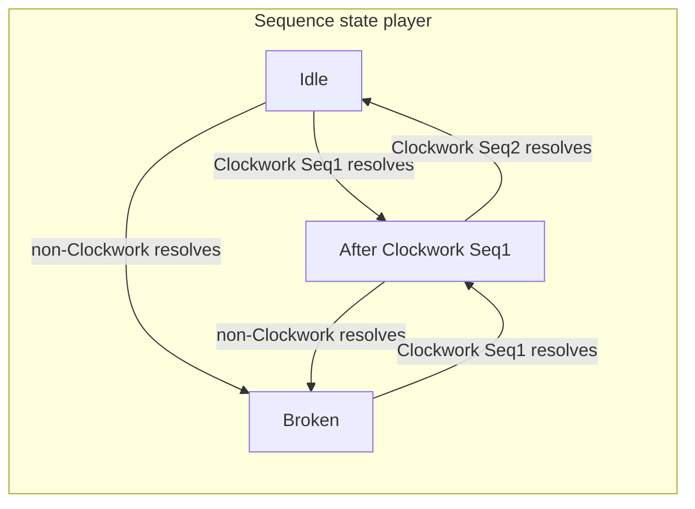

---

name: Clockwork Collective Faction
overview: Design and implementation plan for the Clockwork Collective faction with **Prime** (slots 3, 5, 7) and **Sequence** (1–5 ladder) mechanics, including authored card kits for awakening 0 and 1, balance targets vs all–Basic Strike opponents, and engine/state additions aligned with the existing combat queue model.
todos:

- id: types-state
content: Add FighterState fields + keyword/effect types for Prime, temporary prime, Sequence; faction string `clockwork`
status: pending
- id: engine
content: "Implement gating: prime slot check, Prime riders as DirectHpDamage vs Sequence StrikeDamage + potency, sequence chain update, non-clockwork clears chain"
status: pending
- id: content-aw0
content: Author awakening0.json Clockwork kit (~11 cards) Seq1/2, Prime direct, Prime Choral, Hymn Shelter + Prime Purification
status: pending
- id: content-aw1
content: Author awakening1.json payoffs (Seq3–5, temporary prime, slot buffs)
status: pending
- id: tests-balance
content: Add combat tests + sim/deck lineup vs basic enemy (40 HP Aw0, 80 HP Aw1)
status: pending

---

# Clockwork Collective — Prime + Sequence

## Combat model (existing)

- **Queue:** 9 slots (`[COMBAT_RULES.queueSize](../src/core/rules.ts)`); empty slots resolve as `[neutral_basic_strike_t1](../src/data/cards/neutral/awakening0.json)` (2 **Strike** damage, 0 charge).
- **Round structure:** Each combat round is **player activation** then **enemy activation** (`[CombatSimulator.run](../src/core/combat/engine.ts)`) — one card resolution per fighter per round.
- **“Turn 9”:** Interpret as **round 9** = nine player resolutions. In the first full pass with `queueCursor` starting at 0, the player hits **1-based slots 3, 5, 7** on **rounds 3, 5, 7** — matching **Prime** slots.

## Prime (design)

- **Prime slots (1-based):** **3, 5, 7** → **0-based indices 2, 4, 6** (consistent with `[glint_aw1](../src/core/traits.ts)` using `queueIndex + 1` for display slots).
- **Damage flavor — “mystical” / non-Strike:** **Prime** damage should **not** use the **Strike** tag path. Author as **direct HP damage** (printed “Deal **X** damage” — no **Strike** keyword on those packets). In data, prefer `**DirectHpDamage`** (`[types.ts](../src/core/types.ts)`) for Prime riders so it does **not** feed enemy **Expose**-on-strike hooks, **Feint** chains, etc., unless you deliberately add a card that bridges both.
- **Balance:** **Direct** Prime riders should be **slightly higher** than an equivalent **Strike** at the same charge tier (rule of thumb **~+1** damage or **~10–15%** — tune in sim) so the mystical lane is not strictly weaker than the combo lane.
- **Card text pattern:** small **baseline** (often **direct** damage or **heal**, not Strike); **Prime:** big **direct** rider on slots 3 / 5 / 7 — reads like **sanction / geometry**, not a punch combo.
- **Extra systems:**
  - **Buff cards in prime slots:** implemented as auras or `FighterState` flags (e.g. `primeSlotDamageBonus: Record<queueIndex, number>` or keyed by slot).
  - **Temporary prime:** “Next **N** distinct queue positions resolve as Prime” — store `temporaryPrimeRemaining: number` and decrement when a resolution consumes one, **or** mark the next N **slot indices** that will be treated as prime when visited (clearer for “next 2 slots”).
  - **Already primed → +1 energy:** when applying temporary prime to a slot that is **naturally** prime, grant **+1 charge** once (needs dedupe per application).

## Sequence (design)

- **Strike / combo flavor:** **Sequence** lines are the **fighting-game string** — **Strike** damage (`StrikeDamage`), multi-hit feel, and **scaling** via `**AddStrikePotency`** (and future strike-tagged riders) so the chain **ramps** like a combo (`AddStrikePotency` in `[runner.ts](../src/core/effects/runner.ts)`). Weave **+1 / +2 potency** on **Sequence Start** or **Sequence 2+** bonuses on several cards so later **Strikes** in the fight hit harder.
- **Ladder:** Cards carry **Sequence** labels (e.g. keyword specs or a new field) with one or more numbers **1–5**. Awakening 0 content only needs **1 and 2**; Aw1 extends toward **3–5** for bigger payoffs.
- **Rule (your clarification):** **Non-Clockwork plays break the sequence chain.** Concretely for implementation:
  - On each **player** card resolution, if `card.faction !== 'clockwork'` (exact string TBD to match JSON), set sequence state to **broken / idle** (no expected next step).
  - If the card **is** Clockwork, evaluate Sequence: **Sequence 1** cards can always fire their “opener” line; **Sequence N>1** bonus lines require that the **previous player resolution** was a Clockwork card that **completed** the **N−1** step (see state below).
- **Cards with multiple Sequence numbers:** Author as a set, e.g. `{1,2}` — effect pipeline branches: behaves as **1** when chain is idle; can also **bridge** to **2** when previous step was **1** (single card can restart or continue — tune per card).

**Suggested minimal state on `[FighterState](../src/core/types.ts)`:**

- `clockworkSequencePrev: number | null` — highest **completed** sequence step from the **immediately previous Clockwork** resolution (or `null` if idle/broken).
- Reset to `null` when a non-Clockwork card resolves (including neutral basics).

**Resolution order:** Update `clockworkSequencePrev` **after** the card’s effects resolve (consistent with trait `onCardResolved` timing in `[resolver.ts](../src/core/combat/resolver.ts)`).

## Engine work (implementation outline)

| Area              | Work                                                                                                                                                                                                                                                                                                                               |
| ----------------- | ---------------------------------------------------------------------------------------------------------------------------------------------------------------------------------------------------------------------------------------------------------------------------------------------------------------------------------- |
| Types             | `KeywordSpec` extension or parallel authoring for `Prime` / `Sequence`; optional `EffectStep` branches: `BranchIfOnPrimeSlot`, `BranchIfClockworkSequence`, `GrantTemporaryPrime`, `BuffPrimeSlots`.                                                                                                                               |
| Resolver / runner | Pass `queueIndex` into pipeline context (already available in `[resolveCard](../src/core/combat/resolver.ts)`); implement prime checks and sequence gating in `[runner.ts](../src/core/effects/runner.ts)` — **Prime** riders often `**DirectHpDamage`**; Sequence riders `**StrikeDamage`** + `**AddStrikePotency**` as designed. |
| Expand            | If any branch depends on snapshot-only data, extend `[expandEffectSteps](../src/core/effects/expandEffects.ts)` similarly to junk/core branches.                                                                                                                                                                                   |
| Content           | New JSON packs: e.g. `[src/data/cards/clockwork/awakening0.json](../src/data/cards/clockwork/awakening0.json)`, `awakening1.json`; `faction: "clockwork"`, `neutral: false`, `awakening_min` 0/1.                                                                                                                                  |
| Pilots            | Add pilot(s) in `[pilots.ts](../src/core/pilots.ts)` + traits in `[traits.ts](../src/core/traits.ts)` when ready (can ship cards before full pilot roster).                                                                                                                                                                        |
| Docs              | Short design blurb (only if you want parity with `[docs/scavenger-cards.md](scavenger-cards.md)`) — optional.                                                                                                                                                                                                                      |
| Balance           | Add a **deck duel** or **forge sim** lineup: player all-Clockwork queue vs enemy **nine** `neutral_basic_strike_t1` (or full 9-slot basic line); optionally **enemy HP ×2** for Aw1 goal (`[COMBAT_RULES.startingHp](../src/core/rules.ts)` is 40 — override in test/setup only).                                                  |

## Balance targets (design intent)

- **Baseline threat:** All-basic enemy deals **2 HP/round** before block — **18** damage over **9** rounds if unmitigated.
- **Aw0 vs 40 HP basic enemy:** Win by **round 9** with a **pure Clockwork** queue (no neutrals — they **break Sequence**), or win slower by **out-valuing** via **Prime** burst + blocks. Rough average damage needed to kill in 9 rounds: **~4.4 HP/player round** (ignoring shield decay nuances) — **Prime** turns (3, 5, 7) and **Sequence 2** payoffs carry the spike.
- **Aw1 vs “double our health” (80 HP enemy, 40 player):** Cards add **flex** (extra Sequence steps, prime setup, charge), **bigger payoffs** on **Sequence 3+**, and/or **sustain** so the line can close **within fatigue window** (`maxRounds` 24) or faster.

---

## Sequence wording on cards (rules text)

Use these **exact phrases** on printed card rules (engine may still store `sequenceStep: 1 | 2 | 3` internally):

| Step                 | Rules line          |
| -------------------- | ------------------- |
| Open / restart chain | **Sequence Start:** |
| Second link          | **Sequence 2:**     |
| Third link           | **Sequence 3:**     |
| Fourth link (Aw1)    | **Sequence 4:**     |

**Card text pattern:** small **baseline** always; **Sequence Start / 2 / 3** lines are the **bonus** when that step’s gate is satisfied — prefer **Strike** + occasional **potency** on those lines. **Prime**-focused cards: **weak baseline** (often **direct** damage or **heal**, not Strike), **Prime:** strong **direct** rider on slots 3 / 5 / 7. **Mixed** cards (Sequence + Prime on one line) should **split** types: Sequence packet = **Strike**, Prime packet = **direct** (see **Follow-Up Corollary** below).

**Healing (faction flavor):** Religious-order fantasy is supported with **HealSelf**-style effects (`HealSelf` in `[runner.ts](../src/core/effects/runner.ts)`). Pair **small heals** with **Prime** aggression so the faction still reads **order + math**, not pure lifegain.

**Card titles (Sequence 2 payoffs):** use **Successor**, **Succeeding**, *or* **Follow Up** in the title — pick whichever reads better with the rest of the name (all refer to the same **Sequence 2:** rules line). **Successor** / **Succeeding** lean **math** (e.g. successor step, succeeding case). **Follow Up** / **Follow-Up** lean **liturgical** (“the follow-up reading,” “the next motion”). **Prime**-prefixed names still suit prime-slot identity.

`**Hymn:`** **Persistent** cards use the title pattern `**Hymn:`** *subtitle* (e.g. **Hymn: Warmth**) so players learn **ongoing liturgy** at a glance; still include the **Persistent** keyword in data for **Continuous / Persistent** deck limits.

---

## Proposed Aw0 cards (11; all `faction: clockwork`, `awakening_min: 0`)

Author at **tier 1** unless merge ladder is added later. Stats are sim starting points.

1. **Opening Lemma** — Strike **1**. **Sequence Start:** Strike **2**, **+1** strike potency. Charge **1**. *Combo starter; potency seeds later Strikes in the fight.*
2. **Prime Interdict** — Deal **1** damage (direct, not **Strike**). **Prime:** Deal **5** damage (direct — tuned **above** a comparable **Strike** packet). Charge **1**. *Mystical “interdiction” on prime slots.*
3. **Succeeding Lemma** — Strike **1**. **Sequence 2:** Strike **4**, **+1** strike potency. Charge **1**. *Chain payoff; potency ramp.*
4. **Canonical Aegis** — Block **3**. **Sequence Start:** Block **6**. Charge **1**. *Cheap filler + big block when opening or refreshing the chain.*
5. **Follow-Up Bridge** — Strike **1**. **Sequence 2:** Strike **3**, **+2** strike potency. Charge **1**. *Fighting-game string; big potency bump on the follow-up.*
6. **Prime Bulwark** — Block **3**. **Prime:** **+4** block. Charge **1**. *Defense spike on prime slots (still no Strike path).*
7. **Capacitor Canticle** — Gain **1** charge. **Sequence Start:** gain **+1** charge, **Strike 2**, **+1** strike potency. Charge **0**. *Battery + combo setup.*
8. **Follow-Up Corollary** — Strike **1**. **Sequence 2:** Strike **3** (Strike). **Prime:** Deal **3** damage (direct — **not** Strike). Charge **1**. *Explicit split: combo body vs mystical prime rider.*
9. **Prime Purification** — Heal **3**. **Prime:** Deal **4** damage (direct). Charge **1**. *Heal + sanctified damage; rider bumped vs old **Strike** version.*
10. **Prime Choral** — Deal **1** damage (direct). **Prime:** for the rest of this combat, cards you **resolve** from **prime** slots **3 / 5 / 7** deal **+1** damage (**Strike** and **direct** — author as aura / hook; tune **+2** at higher tier). Charge **1**. *Prime-slot damage engine; pairs with **Follow-Up Lattice** (potency vs flat bonus).*
11. **Hymn: Shelter** — **Persistent**, `**Hymn:`** title. **Start of your turn:** gain **1** block (shield). **When you resolve a card on a Prime slot** (prime **activation**): heal **2** HP. Charge **1** (tune). *Defensive hymn at Aw0; counts toward **Continuous / Persistent** deck cap alongside **Hymn: Warmth** — pick **two** max combined.*

**Kit notes:** Fill all nine slots with Clockwork if using strict chain-break rules. Curve: **Sequence** cards carry **Strike + potency** scaling; **Prime**-named cards emphasize **direct** damage or **heal** + **direct**; **Prime Choral** buffs **damage from prime slots**.

---

## Proposed Aw1 cards (`awakening_min: 1`)

Focus: **Sequence 3** finishers, **temporary Prime**, **slot auras**, **sustain**, tools vs **80 HP** basic line.

1. **Third Canticle** — Strike **1**. **Sequence 3:** Strike **7**, **+2** strike potency. Charge **2**. *Big **Strike** finisher; tune numbers in sim.*
2. **Prime Consecration** — Deal **2** damage (direct). **Prime:** the next **two** distinct slot resolutions count as **Prime**; if a visit is already natural **Prime**, **+1** charge. Charge **1**. *Setup card — mystical baseline, not a **Strike**.*
3. **Follow-Up Lattice** — Block **2**. **Sequence 2:** cards in **prime** slots gain **+2** strike potency until end of combat (aura by slot). Charge **2**. *Sequence-side scaling engine.*
4. **Induction Hymn** — Strike **1**. **Sequence Start:** Strike **2**, **+1** potency; **Sequence 2:** Strike **3**, **+1** potency; **Sequence 3:** Strike **4**, **+2** potency (additive **Strike** packets — tune). Charge **2**. *Full combo in one card; potency stacker.*
5. **Fourth Witness** — Strike **1**. **Sequence 4:** Strike **8**, **+2** strike potency. Charge **3**. *Boss **Strike** payoff.*
6. **Hymn: Warmth** — Title pattern `**Hymn:`** *name* signals **rest-of-combat** / **Persistent** (still author **Persistent** in data for deck rules). **Start of your turn:** heal **2** HP. **When you resolve a card on a Prime slot (3 / 5 / 7):** deal **5** damage (direct — bumped vs Strike alternatives). Charge **2** (tune). *Prime = direct sanctified damage, not **Strike**.*

**Kit notes:** Aw1 justifies **higher charge** with Aw0 energy engines and **Prime Consecration** tempo; **Sequence** finishers lean **Strike + potency**; **Prime** and **Hymn** lean **direct** damage / **heal** for the **mystical** lane.

---

## Proposed pilots (`faction: clockwork`)

Wire later like `[PilotDef](../src/core/pilots.ts)` + `[TRAIT_REGISTRY](../src/core/traits.ts)`: each row is **label**-ready copy; **IDs** are stubs.

### 1. Father Time — *Cantor of the Open Book*

**Flavor:** Teaches that the liturgy has room for silence between verses — neutrals are not heresy, only interruption. Time is merciful if you know where to stand.

| Tier     | Trait ID (stub)              | Rule (player-facing)                                                                                                                                                                                                                                                                                                                                                                                                                                                   |
| -------- | ---------------------------- | ---------------------------------------------------------------------------------------------------------------------------------------------------------------------------------------------------------------------------------------------------------------------------------------------------------------------------------------------------------------------------------------------------------------------------------------------------------------------- |
| **Base** | `clockwork_father_time_base` | **Neutral** card resolutions **do not** reset **Sequence** chain state (your **Sequence Start / 2 / 3** expectation survives neutral staples and blank basics). *Clockwork* cards still advance or complete steps as usual.                                                                                                                                                                                                                                            |
| **Aw0**  | `clockwork_father_time_aw0`  | Each time you **resolve** a **Clockwork** card from a **natural Prime** slot **(3 / 5 / 7)** — **no per-combat limit** — **heal 2** HP. *(Still “restrictive” in that you must actually land on those slots; tune heal **2** vs spam.)*                                                                                                                                                                                                                                |
| **Aw1**  | `clockwork_father_time_aw1`  | **Sequence:** Whenever a **Sequence** bonus line **resolves** (the step actually fires), deal **direct** damage to the enemy equal to that step’s **number** — **Sequence Start → 1**, **Sequence 2 → 2**, **Sequence 3 → 3**, **Sequence 4 → 4** (not **Strike**). **Prime:** Each time you **resolve** a card on a **Prime** slot **(natural or temporary)**, gain **+1 strike potency** until end of combat (**stacks** once per Prime resolve this battle — tune). |

**Power note (Aw1):** Intentionally strong in **long** fights: non-elite combats may end in **~14** player activations today (upper bound), while **fatigue** / pressure usually makes **longer** fights harder — so snowballing is acceptable **for now**; numbers are **tunable**. **Natural** Prime visits are **at most three per full queue cycle** **(slots 3 / 5 / 7)** unless you invest in **temporary Prime** — which typically **competes** with **Sequence** setup, so both rails are not “free.”

**Playstyle:** Forgiving **Sequence** + **Prime** scaling + sustain on natural primes; best for runs heavy on neutrals and for pilots who full-cycle the program.

---

### 2. Theorem Rook — *Geometer Exemplar*

**Flavor:** Believes sanctity lives in fixed positions; the spiral is proof, not ornament. The first steps of the program are not prelude — they are **already** on the holy indices.

| Tier     | Trait ID (stub)       | Rule (player-facing)                                                                                                                                                                                                                                                                                                                                                                                                                                   |
| -------- | --------------------- | ------------------------------------------------------------------------------------------------------------------------------------------------------------------------------------------------------------------------------------------------------------------------------------------------------------------------------------------------------------------------------------------------------------------------------------------------------ |
| **Base** | `clockwork_rook_base` | **Geometer Prime (pilot override):** **Display slots 1** and **2** count as **Prime** for you in addition to the faction’s **3 / 5 / 7**. Your natural **Prime** positions are **1, 2, 3, 5, 7** (1-based); **4, 6, 8, 9** are not unless a card grants **temporary Prime**. **Prime**-tagged **direct** damage you deal is **+1** (after other modifiers; min 0). *Implementation: `isPrimeSlot(actor, queueIndex)` checks pilot trait + temp flags.* |
| **Aw0**  | `clockwork_rook_aw0`  | **Temporary Prime** (from cards like **Prime Consecration**) lasts **one** extra **slot visit** beyond the printed number.                                                                                                                                                                                                                                                                                                                             |
| **Aw1**  | `clockwork_rook_aw1`  | Once per **full queue cycle**, the **first** time you resolve **display slot 7** **(1-based)** this cycle, gain **+1 charge**. *(Capstone of the faction Prime line — clear regardless of visit order.)*                                                                                                                                                                                                                                               |

**Playstyle:** **Prime** / **direct** focus; **slots 1–2** get **Prime** riders and triggers early; rewards **Prime Choral**, **Purification**, **Warmth** spikes.

---

### 3. Canon Verity — *Induction Inquisitor*

**Flavor:** The chain must tighten; mercy is finishing the proof.

| Tier     | Trait ID (stub)         | Rule (player-facing)                                                                                                                                                                           |
| -------- | ----------------------- | ---------------------------------------------------------------------------------------------------------------------------------------------------------------------------------------------- |
| **Base** | `clockwork_verity_base` | When a **Sequence 2** bonus **fully resolves** (activated line, not whiff), gain **+1 strike potency** until end of combat (cap **+3** — tune).                                                |
| **Aw0**  | `clockwork_verity_aw0`  | **Sequence Start** **Strike** packets deal **+1** damage if you paid **charge** for that card this resolution. *(If baseline 0-cost, tie bonus to “first Sequence Start each round” instead.)* |
| **Aw1**  | `clockwork_verity_aw1`  | The first time each combat a **Sequence 3** bonus **fully resolves**, deal **3** damage to the enemy (**direct**, not **Strike**).                                                             |

**Playstyle:** **Sequence** combo + potency scaling; strict, rewards clean strings.

---

**Roster note:** Three pilots mirror the **Scavengers** count; pick art names later. **Father Time** vs **Verity** are **in tension** (neutrals-forgiving snowball vs strict chain) — good for replay identity.

---

## Verification

- **Unit / behavior tests** (pattern in `[src/test/combat.behavior.test.ts](../src/test/combat.behavior.test.ts)`): Prime **direct** damage on indices 2/4/6 only; Sequence **Strike** lines respect potency; Sequence breaks when resolving `neutral_basic_strike_t1`; Seq 2 whiffs if previous resolution was not Clockwork Seq 1 completion.
- **Simulation:** `[forgeDeckSimulation.ts](../src/core/run/forgeDeckSimulation.ts)` / deck duel — assert median **win** vs basic line by round 9 (Aw0) and vs **80 HP** basic (Aw1) after tuning.

