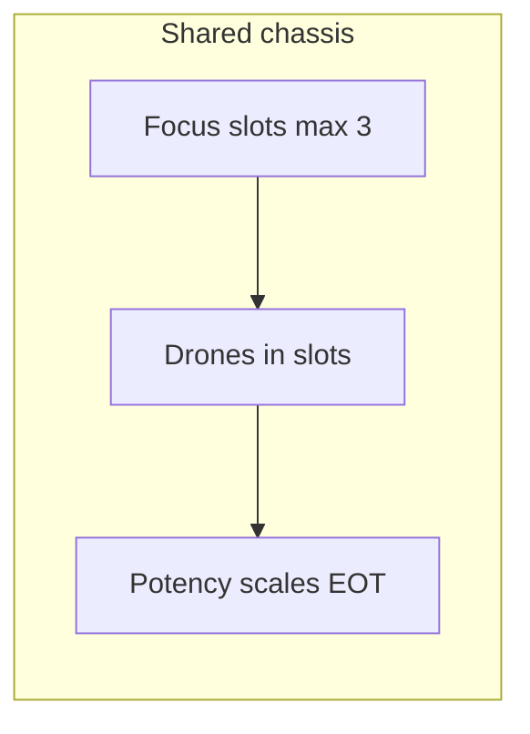

# Silver Swarm: Queen, Doppelganger, and Hound Master (design plan)

**Status:** design exploration — not implemented in combat / `RunState` yet.

**Open todos**

- Decide rotate = destroyed?, Doppelganger energy trigger, and multi-tag card classification for imprints
- Draft 8–12 card names with costs, tiers, and exact Persistent / EOT wording
- Tune drone bases + Self-Destruct vs forge basic-strike sim (rounds 1–12 damage/block)
- When implementing: add `FighterState` drone/focus + `onRoundEnd` or post-activation EOT + trait branches

---

## Shared chassis (Defect-like)

**Terminology:** Call the three slots **Focus** (max 3 by default) — each occupied slot holds **one drone**. Drones are **not** cards in hand; they are persistent battlefield objects (like orbs) that **rotate** when new drones are summoned into a full row (oldest drops — your “rotated out” trigger).

**Drone types (baseline behavior — see pilots below):**

| Drone            | Default intent                                                                                                                                                              |
| ---------------- | --------------------------------------------------------------------------------------------------------------------------------------------------------------------------- |
| **Strike drone** | Contributes **strike damage at end of your turn** (after queue resolution for that activation, or at a defined pipeline step — must match how you implement “end of turn”). |
| **Shield drone** | Grants **block** at the same moment.                                                                                                                                        |
| **Energy drone** | Grants **+1 charge** at the same moment.                                                                                                                                    |

**Numbers to author later:** Base contribution per drone should scale with **potency** on Queen; Doppelganger may ignore EOT scaling in favor of copy mechanics (below).

**Why this fits the codebase today:** `[FighterState](../src/core/types.ts)` has no drone/focus fields yet; `[TRAIT_REGISTRY](../src/core/traits.ts)` hooks are `onCombatStart`, `onStall`, `onCardResolved` — the file itself lists **future** `onRoundStart` / `onRoundEnd`. EOT drones need a **round-boundary hook** (or a single “after player activation resolves” step in `[src/core/combat](../src/core/combat)`) so Queen’s drones fire predictably.

---

## Pilot A — **Queen** (summon + amplify)

**Fantasy:** Swarm commander — **fill Focus**, **amplify** end-of-turn pressure, convert potency into **more drone throughput** (not only generic potency scaling).

**Suggested base trait (always on):**

- **Focus 3** at combat start.
- When you **summon** a drone (any card effect that puts a drone into a Focus slot), gain **+1 strike potency and +1 shield potency** *or* a smaller fixed **+1 potency** — pick one knob so Queen’s potency isn’t strictly identical to neutral Servo Tune-Up (your instinct is right: potency cards need **extra** upside).

**Awakening hooks (examples, not final copy):**

- **Aw0:** First time each combat your Focus **fills completely**, deal **direct** damage / apply **Expose** / gain a **one-shot Overclock** — a tempo spike that rewards setup.
- **Aw1:** Drone end-of-turn effects **repeat** once if you have **3+ total drones summoned this combat** (or “if Focus is full at EOT”) — a clear Queen payoff.

**Identity contrast:** Queen **likes** cards that **summon**, **retain**, and **burst at EOT**; she is weak if the deck never stabilizes Focus.

---

## Pilot B — **Doppelganger** (imprint / consume)

**Fantasy:** No passive EOT from drones. Instead, drones are **charges** that **imprint** the next matching baseline card.

**Core rule (must be unambiguous in implementation):**

- **Strike drone stock:** The next time you resolve a card whose **primary classification** is **Strike**, **consume one Strike drone** and **add a copy of that card’s effects** (or re-resolve the same `CardDef` once targeting the enemy) — mirror your “copy the strike card that was played.”
- **Shield drone** — same for **Shield** resolutions.
- **Energy drone** — same for the **next card that grants charge** *or* “next non-drone card that spends or produces energy” — you should pick **one** trigger so players can reason about it; “next card with `gain charge` in its effect” is learnable.

**Edge cases to decide up front:**

- **Multi-effect cards:** Define whether a card counts as Strike/Shield by **tag**, **effect pipeline order**, or **dominant effect** — tags (`CardDef.tags`) already exist per `[keywords.md](keywords.md)`.
- **Tier:** Copy at **played tier** (recommended) so tier upgrades matter.

**Suggested awakening:**

- **Aw0:** First imprint each combat costs **no drone** *or* refunds **+1 charge**.
- **Aw1:** When a drone is **consumed**, deal **small direct** damage or **junk** — keeps pressure without relying on EOT.

---

## Pilot C — **Hound Master** (sadistic hunter / boss-first)

**Fantasy:** A cruel hunter who deploys disposable machine hounds, marks prey, and wins through controlled sacrifice. This lane is less "build passive value" and more "debuff, isolate, execute."

**How it differs:**

|                  | Queen              | Doppelganger           | Hound Master                       |
| ---------------- | ------------------ | ---------------------- | ---------------------------------- |
| **Drone job**    | End-of-turn value  | Fuel for copies        | **Intercept** / mitigation         |
| **Tempo**        | Snowball board     | Spike on correct lines | **Debuff then execute**            |
| **Player skill** | Sequencing summons | Card-type tracking     | **Mark timing + sacrifice timing** |

**Suggested base trait (always on):**

- **Focus 3** at combat start (same chassis).
- Treat "drones" as **hounds** in this pilot's trait and card text.
- **Strike hound:** applies **Expose** when triggered.
- **Shield hound:** applies **Weakness** when triggered.
- **Energy hound:** intercepts one instance of incoming damage for the Hound Master (consumed on use).
- Hounds can still be rotated out and destroyed; those events feed destruction payoffs like **Self-Destruct Protocol**.

**Why it fits the faction:** Silver Swarm already leans on **rotation** and **destruction** triggers — Hound Master makes losing units the plan while staying mechanically distinct from Doppelganger.

**Suggested awakenings (boss-first framing):**

- **Aw0:** First hound consumed each combat applies extra **Expose** or upgrades existing debuffs.
- **Aw1:** When a hound intercepts damage, gain an execution bonus (direct damage, charge refund, or finisher potency).

**“Activate all” for Hound Master:** **Release the Pack** — each hound immediately applies its own package (Strike => Expose, Shield => Weakness, Energy => intercept arm). This keeps the action distinct from Queen's raw value burst.

**Boss now, playable later:** ship Hound Master first as a boss ruleset and promote to a playable pilot after debuff + intercept UX is proven fun and readable.

---

### Other archetype directions (if Hound Master is not the pick)

- **Relay / Spotter (offensive setup):** Drones **tag** the enemy; your next **Strike** or **Expose** application gets **+X per drone** (or **Pierce** charges). Plays like **setting up one big turn** instead of Queen’s steady EOT or Doppelganger’s copy chains.
- **Harmonics / Monotype Splicer:** Strong bonus when **all Focus slots hold the same drone type**; **weak** when mixed — rewards **specialized** decks and makes faction cards that **convert** drone types matter.
- **Empty-Hand / Lean Operator:** Bonuses when **Focus is empty** (charge retention, potency) vs when **full** — inverted curve to Queen; high skill ceiling.

---

## “Activate all drones” — unified resolution

You asked what this does for Doppelganger. **Recommended split** so the same card text works for both pilots:

| Pilot            | **Activate All** behavior                                                                                                                                                                                                                                                                                                                                                                                                                 |
| ---------------- | ----------------------------------------------------------------------------------------------------------------------------------------------------------------------------------------------------------------------------------------------------------------------------------------------------------------------------------------------------------------------------------------------------------------------------------------- |
| **Queen**        | Each drone’s **EOT effect fires once immediately** (then optionally still fires at real EOT if you want double-dip — usually **no**: treat “Activate All” as **front-load** only to avoid confusion).                                                                                                                                                                                                                                     |
| **Doppelganger** | **Imprint now:** For each drone type present, **consume one drone** of that type and **immediately perform one imprint** using the **last** Strike / Shield / Energy card that qualifies since combat start (or since last “clear imprints”). If **no prior imprint exists** for a type, fall back to a **token payout** (e.g. Strike drone → deal **2 direct**; Shield → **+3 block**; Energy → **+1 charge**) so the card never whiffs. |
| **Hound Master** | **Release the Pack:** Resolve debuff/intercept hound value now. Strike hounds add Expose, Shield hounds add Weakness, and Energy hounds arm one damage intercept.                                                                                                                                                                                                                                                                         |

This keeps the card **readable** (“Resolve all drones now”) without giving Doppelganger a dead mode.

---

## Card ideas (starter kit)

Organized by job; **costs are placeholders** until you run `[simulateForgeDeckMetrics](../src/core/run/forgeDeckSimulation.ts)` / `[simulateDeckCycleReport](../src/core/run/deckCycleSimulation.ts)` against `neutral_basic_strike_t1`.

**Rules carriers (Persistent):**

- **Self-Destruct Protocol** — *Persistent:* When a drone is **destroyed** (consume, rotate off, or “destroy drone” effect), deal **X** damage to the enemy (**direct** or **strike** — pick for interaction with block/Expose).
- **Assembly Line** — *Persistent:* Your **Basic Strike** (faction basic ID) **summons a Strike drone** when played (once per copy of the passive if you need a cap).
- **Bulwark Fabricator** — *Persistent:* **Basic Shield** summons a **Shield drone** (same pattern).

**Economy / Focus:**

- **+1 Focus** (name TBD) — gain **+1 max Focus** for this combat *or* “empty slot becomes available” — careful: **4 slots** changes balance a lot; alternative is **“gain a temporary 4th slot this round only.”**
- **Hard Reset** — set **Focus to 3** and **clear all drones** *or* **destroy all drones** (synergy with Self-Destruct if destruction counts).
- **Capacitor Banks** — **+3 potency**; **lose 1 Focus** (or **-1 max Focus this combat**) — the “risk/reward” potency card you wanted.

**Potency / scaling:**

- **Hive Accounting** — **High cost:** gain **+1 potency per drone you have summoned this combat** (counter on fighter; already analogous to patterns like `strikeResolutionsThisCombat` in `[FighterState](../src/core/types.ts)`).
- **Emergency Refit** — **High cost:** **Destroy** all drones; **resummon** the same number/types (or “summon three Strike drones”) — combo with Self-Destruct if destroy triggers matter.

**Finishers / tempo:**

- **Synchronize Swarm** — **Activate All** (use the unified table above).
- **Overload Burst** — deal damage equal to **sum of Strike drone potency contributions** *once* — Queen skew.
- **Execution Window** — bonus damage to enemies carrying Expose/Weakness (Hound Master skew).

---

## Balance goal: beat “basic attacks only”

**Benchmark in repo:** Forge preview sim uses an enemy deck of `**neutral_basic_strike_t1` repeated** (`[forgeDeckSimulation.ts](../src/core/run/forgeDeckSimulation.ts)`), 20 rounds, infinite HP — you measure **player damage per round** and stall patterns, not a kill race.

**Your stated goal (turn ~9 lethal or out-value)** is a **paper design target**. To validate:

1. Build a **minimal Silver Swarm list** (basics + 3–5 package cards) and compare **cumulative damage / block / charge** from sim events through round 9–12.
2. Tune **drone base values** so Queen’s **EOT stack** plus **Self-Destruct** damage matches or exceeds **9 × (basic strike output)** adjusted for block — or ensure **Doppelganger** imprint burst reaches the same threshold **after setup turns**.

**Knobs:** drone base damage/block/charge; Queen’s extra potency on summon; Self-Destruct damage; Focus reset / high-cost refit numbers; Doppelganger fallback payouts on “Activate All.”

---

## Implementation footprint (when you code it)

**Data / state**

- Extend `[FighterState](../src/core/types.ts)` with something like: `focusMax`, `drones: Array<'strike'|'shield'|'energy'|null>` (or parallel stacks), `dronesSummonedThisCombat`, optional `lastImprintCardIds` for Doppelganger.
- Add **trait IDs** in `[pilots.ts](../src/core/pilots.ts)` + entries in `[TRAIT_REGISTRY](../src/core/traits.ts)`; pilot-specific logic branches on `queen_base` vs `doppelganger_base` vs `hound_master_base`.

**Engine**

- **EOT resolution** for Queen: new combat phase or `onRoundEnd` trait hook (listed as future in traits header).
- **Doppelganger imprint:** extend `**onCardResolved`** (already fires after full resolve) to detect Strike/Shield/Energy classification and consume drones.
- **Persistent** carriers: either new `CardDef` fields + compiler steps in `[src/core/effects](../src/core/effects)` or auras — `[keywords.md](keywords.md)` notes Persistent as **proposed**.

**Content**

- Author cards in JSON with tier ladders like existing neutrals (`[neutral-cards.md](neutral-cards.md)` pattern).
- Optional: link to `[TODO/silicon-swarm-and-ranged-mechanics.md](TODO/silicon-swarm-and-ranged-mechanics.md)` as the **canonical** Silver/Silicon swarm note when you start filling it (only if you want that doc populated).

---

## Open design choices (resolve before implementation)

1. **Rotate behavior:** When Focus is full and a new unit arrives, does the **pushed-out** drone/hound count as “destroyed” for Self-Destruct? (Recommend **yes**.)
2. **Weakness mapping:** Should "Weakness" be a new debuff, or mapped onto an existing mitigation stat/rule in the current engine?
3. **Boss-first boundary:** Keep Hound Master boss-only in phase 1, then convert to playable pilot after readability and tuning pass.

